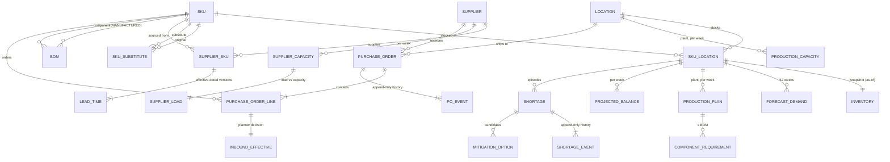
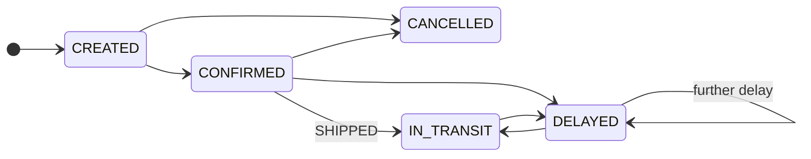
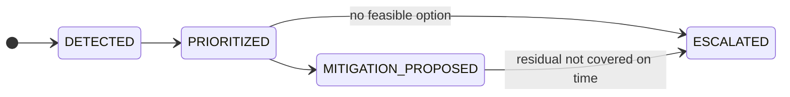

# Entity-relationship model

GitHub renders the Mermaid diagram below automatically. Full field-level detail is in
[data_dictionary.md](data_dictionary.md).

## Cardinality summary

| relationship | cardinality | implemented by | optional? |
|---|---|---|---|
| SKU - Location | N:M | bridge `sku_location` | a SKU must be stocked at >=1 location |
| SKU - SKU (substitutes) | N:M | bridge `sku_substitute` (+ `approval_status`, effective dates) | optional |
| Supplier - SKU | N:M | bridge `supplier_sku` (MOQ, multiple, price, primary flag) | purchased SKUs have >=1 source, exactly 1 primary |
| SKU (parent) - SKU (component) | N:M | bridge `bom` | only MANUFACTURED parents |
| supplier_sku - lead_time | 1:N | `lead_time.version`, `effective_from/to` | >=1 version, non-overlapping |
| Supplier - supplier_capacity | 1:N | one row per supplier-week | mandatory |
| sku_location - forecast_demand | 1:N | one row per week | FINISHED / MANUFACTURED only |
| sku_location - inventory | 1:1 per snapshot | `snapshot_date` | mandatory |
| purchase_order - purchase_order_line | 1:N | `po_id` | >=1 line |
| purchase_order - po_event | 1:N | `event_seq` | >=1 event (CREATED) |
| purchase_order_line - inbound_effective | 1:1 | `po_line_id` | derived |
| shortage - mitigation_option | 1:N | `shortage_id` | optional (0 options possible -> escalated) |
| shortage - shortage_event | 1:N | `event_seq` | >=2 events |

## Lifecycles (state changes are stored as events, never overwritten)

`purchase_order.expected_receipt_date` is the original promise and is **never changed**; each delay
adds a `DELAYED` event with `revised_eta`. `purchase_order.po_status` is derived from the latest event.

Other effective-dated / lifecycle fields: `sku.lifecycle_status` (PHASE_IN -> ACTIVE -> PHASE_OUT),
`supplier.supplier_status` (ACTIVE / ON_HOLD), `sku_substitute.approval_status` (PENDING -> APPROVED / REJECTED),
`production_plan.plan_status` (PLANNED -> FIRM inside the 4-week fence), `lead_time` versions.
